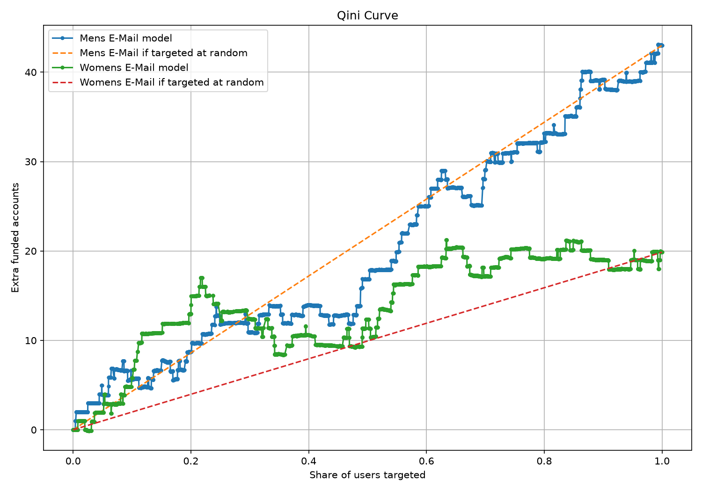

### Deposit Match Email Test

##### Paul Taiwo-Adeyemo, November 2026

### Introduction

A company wants to know if sending customers an email about a deposit match gets more of them to put money in their account. Two emails were tested against a group that got no email. The data comes from a retail email test, and it is used here as a stand-in for that deposit offer. Conversion means the account was funded, and spend means the deposit amount.

#### Business Question

The aim of this analysis is to decide which email, if any, should be sent.

> 1. Does the men's email get more customers to fund an account than sending nothing?
> 2. Does the women's email do the same?
> 3. If both emails work, which one should be sent?
> 4. Would it be better to send the email only to some customers, instead of everyone?

#### Dataset Description

The dataset is the Hillstrom MineThatData email experiment. About 64,000 customers were split at random into three groups of about 21,000.

> No E-Mail is the group that got no message. This is the comparison group.
>
> Mens E-Mail is creative A.
>
> Womens E-Mail is creative B.

The outcome window is two weeks. History is how much the customer deposited in the prior year.

### Order of Analysis

> 1. The decision rule was written down before the results were looked at.
>
> 2. The data was loaded and checked.
>
> 3. The two emails were compared with the no-email group.
>
> 4. A check was made for what happens if the results are looked at too early.
>
> 5. A model was used to see if some customers respond more than others.

### Pre-registration

In this step the rules were written down first, in [docs/experiment_brief.md](docs/experiment_brief.md). The main number is the funding rate, which is the share of customers who deposited. Visit rate and deposit per customer are supporting numbers. Deposit per funded customer is a check that the email did not make each depositor put in a lot less money. The groups also had to stay close to the same size. If both emails passed, the one with the larger funding-rate lift would be sent.

### Data

In this step the file was loaded into DuckDB, and dbt was used to make one row per customer. Tests checked that each customer appears once, that the group names are valid, and that deposits are not negative. There were 21,306 customers in the no-email group, 21,307 in the men's email group, and 21,387 in the women's email group. The group sizes are close enough (p = 0.90), so the split looks fine.

### Results

In this step each email was compared with no email. The full numbers are in [docs/readout.md](docs/readout.md).

The funding rate with no email was 0.57%. The men's email raised it by 0.68 percentage points, to 1.25%. The women's email raised it by 0.31 percentage points. Both lifts are very unlikely to be luck. Per 10,000 customers emailed, that is about 68 extra funded accounts and about 7,700 extra deposits for the men's email, and about 31 extra funded accounts and about 4,200 extra deposits for the women's email.

The chart below shows the funding rate in each group.


The next chart shows the lift of each email compared with no email. The lines on the bars are the 95% confidence intervals.


The extra deposits come from more people funding an account, not from larger deposits. The deposit per funded customer barely moved. CUPED, which uses last year's deposits to make the comparison less noisy, did not help. Last year's deposits barely predict what someone deposits in these two weeks.

### Checking the Test Too Early

A separate simulation looked at what happens if a test with no real difference is checked 100 times. A normal z-test called a winner 39% of the time. mSPRT, which is built for checking along the way, called a winner about 3% of the time. This analysis was only looked at once, at the end, so that problem does not change the decision. The chart below shows the simulation.


### Targeting

A model was fit to see if some customers respond more than others. For the men's email the model did not beat sending the email to everyone. For the women's email there was some signal, mostly among customers who deposited more than $750 in the prior year. This part is exploratory and was not used to pick the winner.



### Discussion and Conclusion

> As it turns out, both emails increased the share of customers who funded an account, and the men's email had the larger lift. The funding rate went from 0.57% to 1.25% for the men's email, and the result is not close. The same pattern shows up in visits and in deposit per customer. What did not change is how much each funded customer deposited, so the gain is more customers depositing, not bigger deposits.
>
> The guardrail on deposit size is weak. Only a few hundred customers in each group funded an account, so the confidence interval is about plus or minus 20%. The men's email still passes the rule that was written down beforehand.
>
> Targeting did not improve on sending the men's email to everyone. CUPED also did not tighten the result, because the prior-year deposit is a poor predictor of the deposit in this two-week window.

### Recommendation

> Send the men's email to all eligible customers. The women's email also worked, but the lift was smaller, and the rule was to send the email with the larger funding-rate lift. If the women's email is ever reused, it would be worth testing it on customers with more than $750 in prior-year deposits.

### Further Work

The cost of the deposit match is not in this data, so the extra deposits are not the same thing as profit. The window is only two weeks, so it is not known whether the funded accounts stay active. A better covariate for CUPED would be deposits in the weeks just before the email, not the whole prior year. This is also a retail email test reframed as a deposit offer, so the method carries over, but the effect sizes should not be quoted as a fintech benchmark.

### How to Run

This project uses uv.

```bash
uv sync
make all
make app
```

`make all` downloads the data, builds the tables, runs the tests, and writes the charts in `results/`. `make app` opens the same readout in a small web app.
