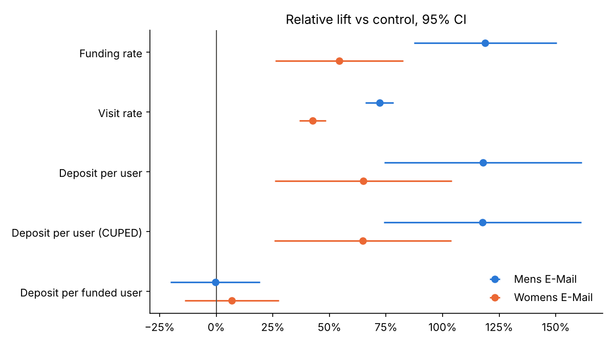

# deposit-nudge-experiment

An end-to-end A/B test readout, from raw data to a ship decision.

The Hillstrom MineThatData email experiment (64,000 customers randomised into three arms)
is framed as a fintech deposit-match promo: conversion means the account was funded and spend means the deposit amount.

| Arm | Role |
|---|---|
| No E-Mail | control |
| Mens E-Mail | creative A |
| Womens E-Mail | creative B |

## Result

**Ship creative A.** It raised the funding rate from 0.57% to 1.25%
(+0.68 pp, 95% CI [+0.50, +0.86], Holm p = 3e-13), which is about 68 extra funded accounts
and 7,700 in extra deposits per 10,000 users messaged. Deposit size per funded account was
unchanged.

Full write-up: [docs/readout.md](docs/readout.md). Pre-registration:
[docs/experiment_brief.md](docs/experiment_brief.md).



## What is in it

- **Pre-registration.** Hypothesis, metrics, MDE and decision rule committed before any
  treatment outcome was looked at. Power analysis uses control baselines only.
- **dbt models** on DuckDB, from raw data to one row per user, with data tests for unique
  users, valid arms and non-negative deposits.
- **`abkit`**, a small stats library written from scratch and tested against hand-computed
  or simulated answers:
  SRM check, two-proportion z-test, Welch t-test, bootstrap CI, CUPED, delta method for
  ratio metrics, Holm correction, mSPRT and a T-learner for uplift.
- **Sequential testing.** A simulation of 2,000 A/A tests shows that checking a z-test
  100 times gives a 39% false positive rate, against 3% for mSPRT.
- **Uplift modelling.** T-learner evaluated with Qini AUC and uplift@k to check whether
  targeting beats sending to everyone. For creative A it does not.
- **Streamlit app** showing the same readout.

## Run it

Needs [uv](https://docs.astral.sh/uv/).

```bash
uv sync
make all
make app
```

`make all` downloads the data, builds the warehouse, runs dbt, runs the tests and writes
`results/`. Individual steps: `make data`, `make dbt`, `make test`, `make lint`, `make readout`.

## Layout

```
data/raw/        raw data (gitignored)
dbt/             staging -> fct_assignments -> fct_experiment_metrics
src/abkit/       stats functions
tests/           pytest for every abkit function
scripts/         load data, power analysis, analysis, peeking simulation, uplift
results/         JSON results and charts
docs/            experiment brief and readout
app/             Streamlit app
```

## Stack

uv, DuckDB, dbt-duckdb, pandas, scipy, statsmodels, scikit-learn, scikit-uplift,
matplotlib, Streamlit, pytest, ruff, pre-commit, GitHub Actions.
