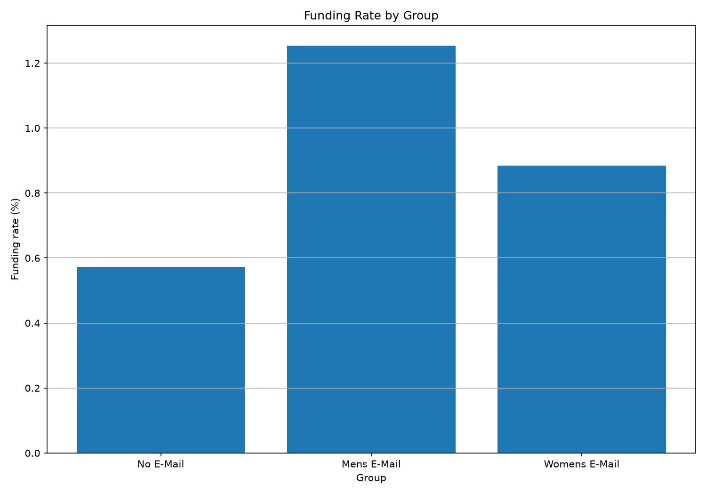
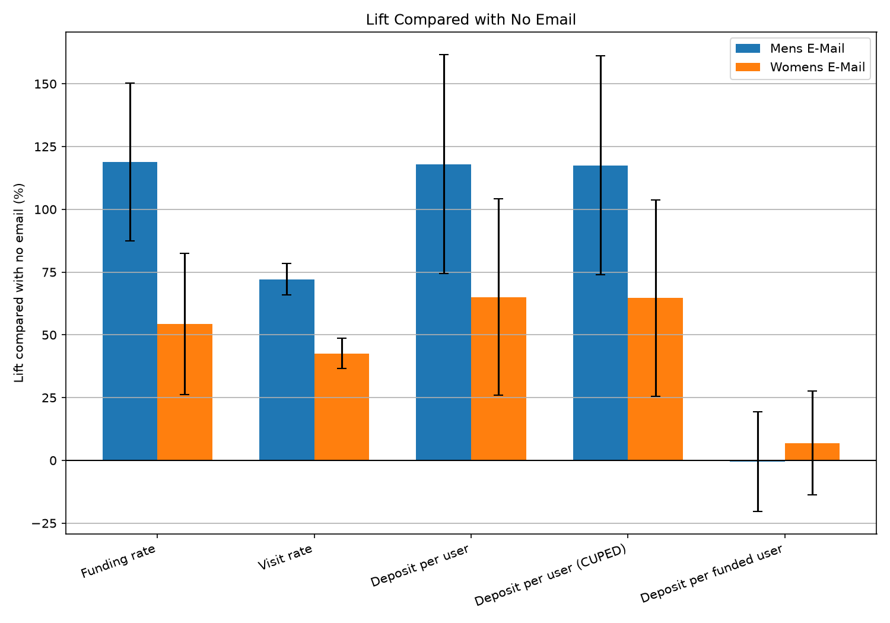
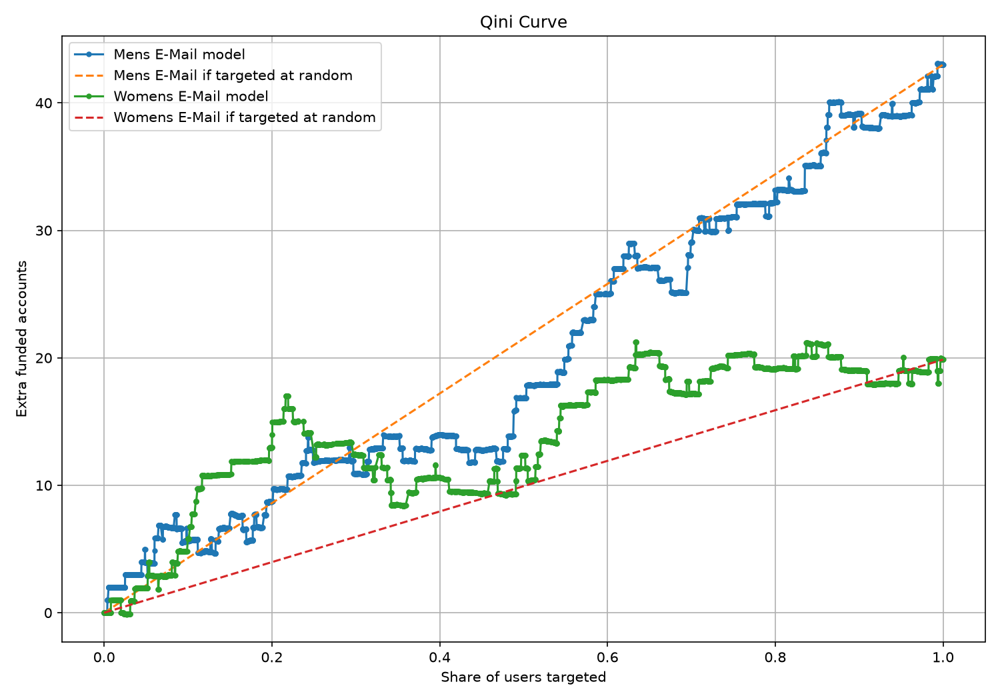
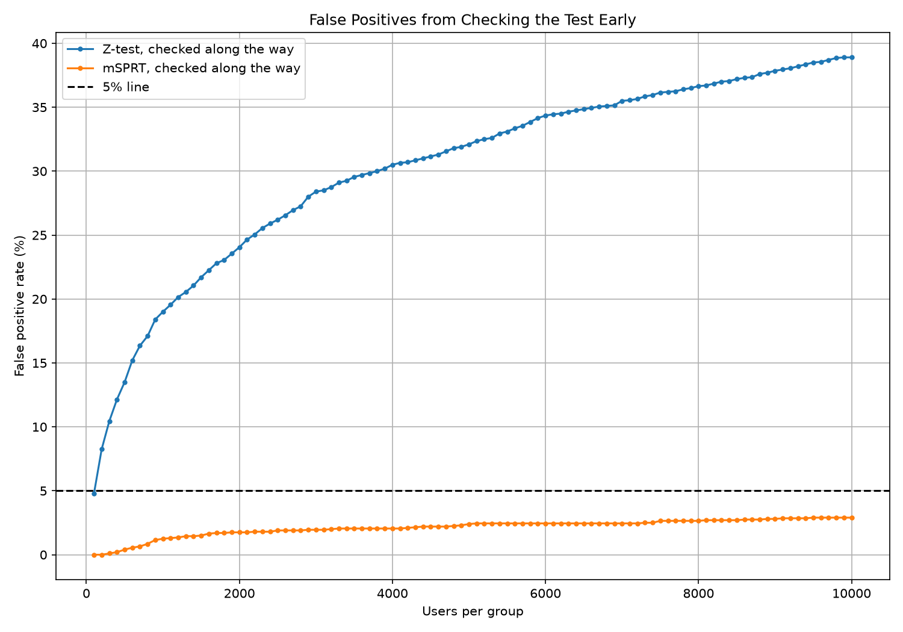

### Readout: Deposit Match Email Test

##### Paul Taiwo-Adeyemo, November 2026

This write-up follows the rules in [experiment_brief.md](experiment_brief.md). The numbers come from `results/` and can be rebuilt with `make all`.

### Decision

Send the men's email to all eligible customers.

Both emails passed the checks that were written down before the results were looked at. The men's email had the larger lift in funding rate, so that is the one that gets sent.

| Check | Men's email | Women's email |
|---|---|---|
| Groups stayed about the same size (p at least 0.001) | p = 0.90, pass | pass |
| Funding rate went up, and the adjusted p-value is below 0.05 | p = 3e-13, pass | p = 0.0002, pass |
| Deposit per funded customer is not clearly down by more than 20% | [-20.2%, +19.4%], pass | [-13.8%, +27.6%], pass |

### Sample

| Group | Customers |
|---|---|
| No email | 21,306 |
| Men's email | 21,307 |
| Women's email | 21,387 |

There is no sign that the random split went wrong. The chi-square p-value is 0.90.

### Effect Sizes

With no email, the funding rate was 0.57%, the visit rate was 10.6%, deposit per customer was 0.65, and deposit per funded customer was 114. The intervals below are 95% confidence intervals.

| Metric | Men's email | Women's email |
|---|---|---|
| Funding rate | +0.68 pp [+0.50, +0.86], +119% | +0.31 pp [+0.15, +0.47], +54% |
| Visit rate | +7.7 pp [+7.0, +8.3], +72% | +4.5 pp [+3.9, +5.2], +43% |
| Deposit per customer | +0.77 [+0.49, +1.05], +118% | +0.42 [+0.17, +0.68], +65% |
| Deposit per customer, bootstrap interval | [+0.50, +1.05] | [+0.18, +0.69] |
| Deposit per customer, CUPED | +0.77 [+0.48, +1.05] | +0.42 [+0.17, +0.68] |
| Deposit per funded customer | -0.5 [-23.1, +22.1], -0.4% | +7.9 [-15.7, +31.5], +6.9% |

The chart below shows the funding rate in each group.

The next chart shows the lift of each email compared with no email. The lines on the bars are the 95% confidence intervals.

### Business Impact per 10,000 Customers Emailed

| | Men's email | Women's email |
|---|---|---|
| Extra funded accounts | 68 [50, 86] | 31 [15, 47] |
| Extra deposits | 7,700 [4,800, 10,500] | 4,200 [1,700, 6,800] |

The lift comes from more people funding an account. The deposit per funded customer is about flat for both emails.

### Targeting

A model was fit for each email on a 70/30 split, to see if some customers respond more than others. This part does not change the decision.

| | Qini AUC | Lift in the top 30% | Average lift |
|---|---|---|---|
| Men's email | -0.022 | +0.57 pp | +0.67 pp |
| Women's email | +0.085 | +0.66 pp | +0.31 pp |

The men's email model does not beat sending the email to everyone. The women's email has some signal. Customers with more than $750 in prior-year deposits respond about 3 to 4 times more than average. That would be worth a follow-up test if the women's email is ever reused.

### Discussion and Conclusion

> CUPED did not help. Prior-year deposits correlate about 0.02 with deposits during the test, so the interval got less than 0.1% narrower. A better covariate would be deposits in the weeks just before the test.
>
> The guardrail is weak. Only about 120 to 270 customers per group funded an account, so the interval for deposit per funded customer is about plus or minus 20%. The men's email passes the rule as it was written, but the data cannot rule out a drop of that size.
>
> The cost of the match is not included. Extra deposits are not the same thing as profit.
>
> The window is two weeks. It is not known whether funded accounts stay active, or whether the effect fades if the email is sent again.
>
> The source data is a retail email test used here as a deposit offer. The method carries over. The effect sizes should not be quoted as a fintech benchmark.
>
> This analysis used one look at the end. If the next test is checked while it is still running, mSPRT should be used. In a simulation of 2,000 tests with no real difference, checking a z-test 100 times gave a 39% false positive rate, against about 3% for mSPRT.

### Recommendation

> Send the men's email to all eligible customers.
